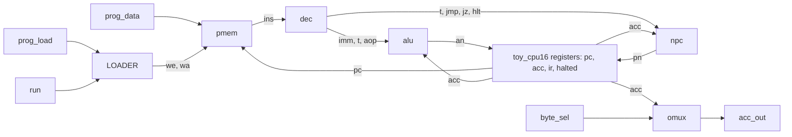

# TCPU-16 Source Guide

This repo walks through every source file of TCPU-16, a tiny 16-bit CPU written in Verilog. Each file gets its own page: a plain-English explanation, a picture, what goes in and out, a small example, and then the actual code.

The CPU is deliberately small. It has one 16-bit register (the accumulator), room for 8 instructions, and 8 kinds of instruction: LOAD, ADD, SUB, SHL, XOR, JMP, JZ and HALT. One instruction runs per clock tick.

The pictures are Mermaid diagrams, so GitHub draws them for you.

## Start here: the big picture



## What happens on one tick

1. The memory hands over the instruction at the current `pc`.
2. The decoder works out what it means.
3. The ALU works out the new accumulator value, and the next-PC block works out where to go next.
4. If the CPU is allowed to run (`run` is 1 and it hasn't halted), the top module saves both answers at once.
5. The output mux shows half of the accumulator on `acc_out`.

Loading a program is a separate path: with `run` at 0, each press of `prog_load` stores `prog_data` in the next free slot.

## The files, in a good reading order

| Page | Source | In one line |
|---|---|---|
| [ops](docs/ops.md) | `rtl/ops.vh` | The codebook of opcode numbers |
| [pmem](docs/pmem.md) | `rtl/pmem.v` | Eight boxes that hold the program |
| [loader](docs/loader.md) | `rtl/loader.v` | Feeds a program into the boxes |
| [dec](docs/dec.md) | `rtl/dec.v` | Translates an instruction into actions |
| [alu](docs/alu.md) | `rtl/alu.v` | Does the maths |
| [npc](docs/npc.md) | `rtl/npc.v` | Decides which instruction comes next |
| [omux](docs/omux.md) | `rtl/omux.v` | Picks which half of the answer you see |
| [toy_cpu16](docs/toy_cpu16.md) | `rtl/toy_cpu16.v` | The boss that ties it all together |
| [tb_toy_cpu16](docs/tb_toy_cpu16.md) | `tb/tb_toy_cpu16.v` | The test that checks it all |

## Names you'll see a lot

| Name | Meaning |
|---|---|
| `pc` | Program counter: which instruction we're on |
| `acc` | The accumulator: the 16-bit number we're holding |
| `ins` | The instruction currently being run |
| `imm` | The small number inside an instruction |
| `t` | Jump target or shift amount |
| `aop` | What the ALU has been asked to do |
| `an` | The ALU's answer (new accumulator) |
| `pn` | Next program counter |
| `exec` | "Go" signal: `run` is 1 and not halted |
| `we`, `wa` | Write now, and which slot |
| `plq`, `lp`, `la` | Loader: previous `prog_load`, new-press signal, slot counter |

## The instructions

| Code | Instruction | What it does |
|---|---|---|
| 000 | LOAD imm | put a number (0 to 31) in `acc` |
| 001 | ADD imm | add a number |
| 010 | SUB imm | subtract a number |
| 011 | SHL sh | shift `acc` left by 0 to 7 |
| 100 | XOR imm | flip some of the bottom 5 bits |
| 101 | JMP t | go to instruction `t` |
| 110 | JZ t | go to `t` if `acc` is 0, otherwise carry on |
| 111 | HALT | stop until reset |

An instruction is 8 bits: 3 for the opcode, 5 for the operand.

## Try it

You need `iverilog`, `verilator` and `yosys`.

```
make lint    # style and sanity check
make sim     # run the tests, look for "errors=0"
make synth   # count the flip-flops, expect 88
```
