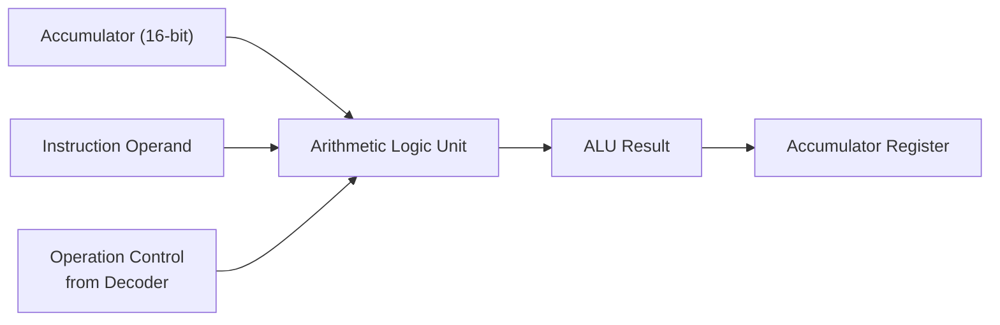

# ALU (Arithmetic Logic Unit)

## 1. Purpose

The Arithmetic Logic Unit (ALU) performs the arithmetic and logical operations required by the TCPU-16 processor. It receives the accumulator value, the instruction operand, and operation control signals from the decoder. Based on the selected operation, it generates the corresponding result.

The supported operations include:

- **LOAD** — loads an immediate operand into the result.
- **ADD** — adds the operand to the accumulator.
- **SUB** — subtracts the operand from the accumulator.
- **SHL** — shifts the accumulator to the left.
- **XOR** — performs a bitwise exclusive-OR operation.

## 2. ALU Block Diagram

### Block Diagram Explanation

- **Accumulator:** Supplies the current 16-bit accumulator value to the ALU.
- **Instruction Operand:** Supplies the immediate value or operation operand derived from the instruction.
- **Operation Control:** Selects the operation that the ALU must perform.
- **ALU:** Executes the selected arithmetic or logical operation.
- **ALU Result:** Carries the computed result to the CPU datapath.
- **Accumulator Register:** Stores the result when enabled by the CPU control logic.

## 3. ALU Operations

Let `A` represent the accumulator value and `B` represent the instruction operand.

| Operation | Result | Description |
|---|---|---|
| LOAD | `B` | Passes the immediate operand to the result. |
| ADD | `A + B` | Adds the operand to the accumulator. |
| SUB | `A - B` | Subtracts the operand from the accumulator. |
| SHL | `A << B` | Shifts the accumulator left by the specified amount. |
| XOR | `A ^ B` | Performs bitwise XOR between the accumulator and operand. |

The exact operand widths, immediate-value extension, shift behavior, and result truncation depend on the RTL implementation and should be verified against `alu.v`.

## 4. Working Principle

1. The instruction decoder identifies the operation from the instruction opcode.
2. The operand is supplied to the ALU.
3. The ALU performs the selected arithmetic or logical operation.
4. The computed result is passed to the CPU datapath.
5. The CPU control logic determines whether the result is written into the accumulator.

## 5. Verification

The ALU should be tested for the following cases:

- Correct immediate-value handling for LOAD.
- Correct addition and subtraction results.
- Correct left-shift behavior for different shift amounts.
- Correct XOR results for different bit patterns.
- Correct handling of 16-bit results and overflow or underflow.
- Correct selection of operations based on decoder control signals.

## 6. Related Modules

- `alu.v` — implements the arithmetic and logical operations.
- `dec.v` — decodes instructions and generates operation control signals.
- `ops.md` — documents the instruction opcodes and operation definitions.
- `toy_cpu16.v` — integrates the ALU with the other CPU modules.

