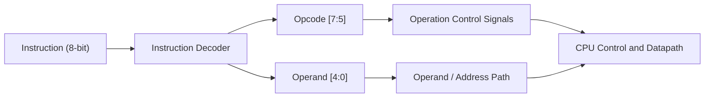

# Instruction Decoder (DEC)

## 1. Purpose

The Instruction Decoder (DEC) identifies the operation to be performed by the TCPU-16 processor by decoding the opcode of the current instruction.

TCPU-16 uses an 8-bit instruction format. The decoder extracts the opcode from bits `[7:5]` and uses it to determine the required operation and associated control signals.

## 2. Block Diagram



### Block Diagram Explanation

- **Instruction:** The 8-bit instruction received from program memory.
- **Opcode `[7:5]`:** The three most significant bits identify the instruction operation.
- **Operand `[4:0]`:** The five least significant bits contain the immediate value, shift amount, or address, depending on the instruction.
- **Operation Control Signals:** Indicate which operation the processor must perform.
- **Operand / Address Path:** Passes the operand to the relevant part of the datapath.
- **CPU Control and Datapath:** Uses the decoded information to execute the instruction.

## 3. Instruction Format

| Bits | Width | Function |
|---|---:|---|
| `[7:5]` | 3 bits | Opcode |
| `[4:0]` | 5 bits | Operand |

The instruction is divided into these fields:

```text
  7 6 5 4 3 2 1 0
 +---------+-----+
 |  Opcode |Operand
 +---------+-----+
```

## 4. Opcode Mapping

| Opcode `[7:5]` | Instruction | Function |
|---|---|---|
| `000` | LOAD | Load an immediate value. |
| `001` | ADD | Add the operand to the accumulator. |
| `010` | SUB | Subtract the operand from the accumulator. |
| `011` | SHL | Shift the accumulator left. |
| `100` | XOR | Perform a bitwise XOR operation. |
| `101` | JMP | Jump to the specified address. |
| `110` | JZ | Jump if the accumulator is zero. |
| `111` | HALT | Halt execution. |

## 5. Working Principle

1. Program memory supplies the current 8-bit instruction.
2. The decoder separates the opcode and operand fields.
3. The opcode is interpreted to identify the required instruction.
4. The corresponding control information is supplied to the CPU datapath.
5. The operand is used according to the instruction type.
6. The CPU executes the instruction and updates its state as required.

## 6. Example

Consider the instruction `0x23`, which represents `ADD 3` under the specified instruction encoding.

```text
Hex instruction = 0x23
Binary          = 00100011

Opcode          = 001
Operand         = 00011
```

The decoder identifies opcode `001` as ADD and the operand as `3`. The CPU then performs the addition according to the ALU and control logic.

## 7. Verification

The decoder should be tested for:

- Correct extraction of opcode bits `[7:5]`.
- Correct extraction of operand bits `[4:0]`.
- Correct identification of all eight opcode values.
- Correct generation of operation control signals.
- Correct integration with the ALU, program memory, and CPU control logic.

## 8. Related Files

- `ops.md` — documents instruction encoding and operation definitions.
- `alu.md` — documents arithmetic and logical operations.
- `pmem.md` — documents program memory.
- `loader.md` — documents program loading.
- `toy_cpu16.v` — integrates the processor modules.
