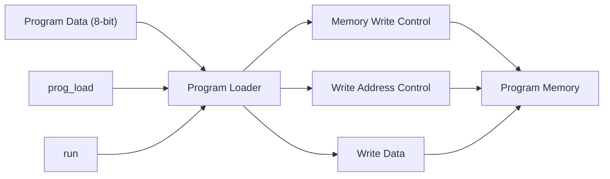

# Program Loader

## 1. Purpose

The Program Loader is responsible for loading instructions into the TCPU-16 program memory before the processor begins execution. It coordinates the program-loading interface and helps prevent normal execution from starting while a program is being loaded.

The loader uses the `prog_load`, `prog_data`, and `run` signals to control the loading sequence.

## 2. Block Diagram

### Block Diagram Explanation

- **Program Data (`prog_data`):** Supplies the instruction data to be loaded.
- **Program Load (`prog_load`):** Indicates that program loading is active.
- **Run (`run`):** Requests normal processor execution.
- **Memory Write Control:** Enables writes to program memory.
- **Write Address Control:** Selects the program memory location to be written.
- **Write Data:** Carries the instruction to program memory.
- **Program Memory:** Stores the loaded instructions for execution.

## 3. Interface Signals

| Signal | Description |
|---|---|
| `prog_load` | Enables the program-loading sequence. |
| `prog_data` | Supplies the instruction byte. |
| `run` | Requests execution of the loaded program. |
| `clk` | Clock signal used for synchronous operations. |
| `rst_n` | Active-low reset signal, if connected to the loader. |

The exact signal widths and additional internal signals depend on the loader RTL.

## 4. Working Principle

1. The processor is kept out of normal execution mode while program loading is active.
2. The instruction data is supplied through `prog_data`.
3. The loader coordinates writes to program memory.
4. After the final instruction is supplied, `prog_load` is deasserted.
5. The required settling or synchronization period is observed.
6. The `run` signal is asserted to begin normal execution.

## 5. Loading and Synchronization Requirements

The TCPU-16 specification defines different timing requirements for Mode H and Mode O.

| Requirement | Mode H | Mode O |
|---|---:|---:|
| `SYNC_STAGES` | 0 | 2 |
| `N = SYNC_STAGES + 1` | 1 | 3 |
| Minimum reset high/low periods | 1 clock edge | 3 clock edges |
| Minimum `prog_load` high/low periods | 1 clock edge | 3 clock edges |

The program data must remain stable while `prog_load` is high.

After the final program word has been loaded, `run` must only be asserted after `prog_load` has remained low for at least `N` clock edges.

These requirements ensure that program loading is completed before normal execution begins.

## 6. Verification

The program loader should be tested for:

- Correct loading of instructions into program memory.
- Correct handling of consecutive program-data bytes.
- Correct behavior while `prog_load` is asserted.
- Prevention of execution during program loading.
- Correct sequencing when `prog_load` is deasserted.
- Compliance with Mode H and Mode O timing requirements.
- Correct handling of reset and the transition to execution.

## 7. Related Files

- `prog_loader.v` — implements the program-loading logic.
- `prog_mem.v` — stores the loaded instructions.
- `toy_cpu16.v` — integrates the loader with the processor.
- `ops.md` — documents instruction encoding and behavior.
- `pmem.md` — documents program memory.
