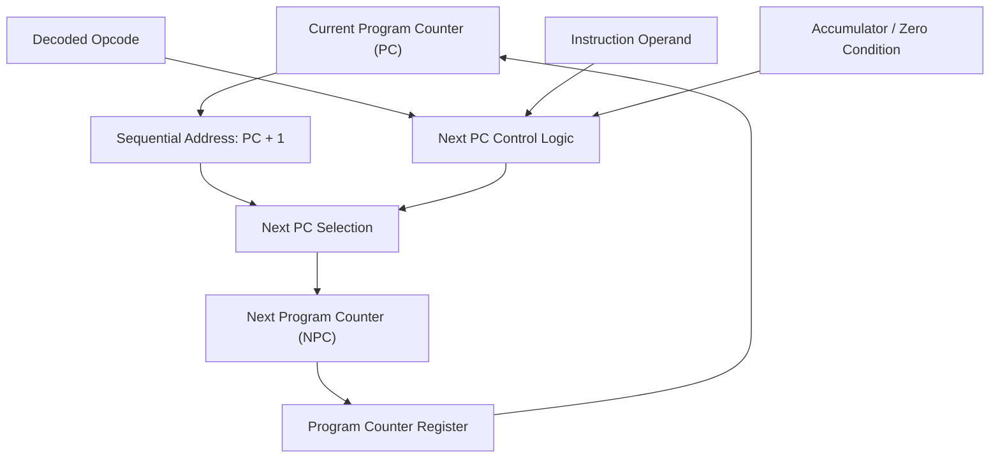

# Next Program Counter (NPC)

## 1. Purpose

The Next Program Counter (NPC) logic determines the address of the next instruction to be executed by the TCPU-16 processor. It supports sequential instruction execution and control-flow changes caused by jump instructions.

The next program counter value depends on the current program counter, the decoded instruction, and the relevant CPU control conditions.

## 2. Block Diagram



### Block Diagram Explanation

- **Current PC:** Holds the address of the instruction currently being executed.
- **Sequential Address:** Calculates the next sequential address, typically `PC + 1`.
- **Decoded Opcode:** Identifies whether the current instruction changes normal program flow.
- **Instruction Operand:** Supplies the target address for jump instructions.
- **Accumulator / Zero Condition:** Provides the condition required by the conditional jump instruction.
- **Next PC Control Logic:** Determines which next-address option should be selected.
- **Next PC Selection:** Selects the appropriate address for the next instruction.
- **Program Counter Register:** Stores the selected address for subsequent instruction fetching.

## 3. Next PC Conditions

| Instruction | Next PC behavior |
|---|---|
| LOAD | Continue to the next sequential instruction. |
| ADD | Continue to the next sequential instruction. |
| SUB | Continue to the next sequential instruction. |
| SHL | Continue to the next sequential instruction. |
| XOR | Continue to the next sequential instruction. |
| JMP | Load the specified jump target. |
| JZ | Load the jump target if the accumulator is zero; otherwise continue sequentially. |
| HALT | Stop normal instruction execution. |

The table describes the intended instruction behavior. The exact handling of the program counter during HALT must follow the RTL implementation.

## 4. Working Principle

1. The current program counter provides the address of the current instruction.
2. The sequential path calculates the next instruction address.
3. The decoder identifies whether the instruction is a normal operation, an unconditional jump, a conditional jump, or HALT.
4. For normal operations, the sequential address is selected.
5. For JMP, the specified target address is selected.
6. For JZ, the accumulator's zero condition determines whether the target address or sequential address is selected.
7. The selected next address is stored in the program counter register according to the CPU's clock and control logic.

## 5. Example

Assume the current program counter is `PC = 2`.

**Sequential execution**

```text
Current PC = 2
Next PC    = 3
```

**Unconditional jump**

```text
Current PC = 2
Instruction = JMP 5
Next PC     = 5
```

**Conditional jump**

```text
If ACC == 0:
    Next PC = jump target
Else:
    Next PC = PC + 1
```

These examples assume the jump operand is interpreted as the target program-memory address.

## 6. Verification

The NPC logic should be tested for:

- Correct sequential address progression.
- Correct target selection for JMP.
- Correct taken and not-taken behavior for JZ.
- Correct handling of the accumulator zero condition.
- Correct interaction with program memory and instruction decoding.
- Correct behavior when HALT is executed.
- Correct program-counter updates on clock edges and during reset.

## 7. Related Files

- `ops.md` — documents instruction opcodes and behavior.
- `dec.md` — documents instruction decoding.
- `pmem.md` — documents program memory.
- `loader.md` — documents program loading.
- `toy_cpu16.v` — integrates the CPU datapath and control logic.
