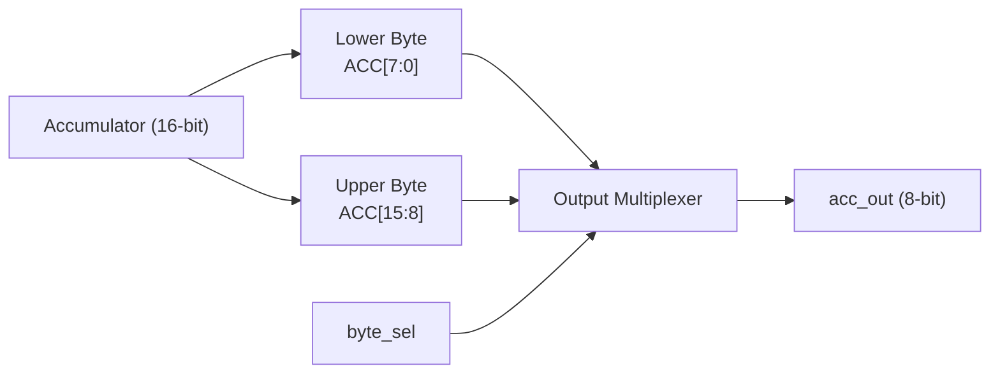

# Output Multiplexer (OMUX)

## 1. Purpose

The Output Multiplexer (OMUX) selects which byte of the 16-bit accumulator is presented at the CPU's 8-bit output port.

The TCPU-16 accumulator is 16 bits wide, while the external output `acc_out` is 8 bits wide. The `byte_sel` signal selects either the lower or upper byte of the accumulator.

## 2. Block Diagram



### Block Diagram Explanation

- **Accumulator:** Provides the 16-bit result stored by the CPU.
- **Lower Byte:** Contains accumulator bits `[7:0]`.
- **Upper Byte:** Contains accumulator bits `[15:8]`.
- **`byte_sel`:** Controls which accumulator byte is selected.
- **Output Multiplexer:** Routes the selected byte to the output.
- **`acc_out`:** The resulting 8-bit output.

## 3. Interface Signals

| Signal | Width | Description |
|---|---:|---|
| `acc` | 16 bits | Accumulator value supplied to the multiplexer. |
| `byte_sel` | 1 bit | Selects the lower or upper byte. |
| `acc_out` | 8 bits | Selected accumulator byte. |

## 4. Selection Logic

| `byte_sel` | Selected Bits | Output |
|---:|---|---|
| `0` | `ACC[7:0]` | Lower 8 bits |
| `1` | `ACC[15:8]` | Upper 8 bits |

The output selection can be represented conceptually as:

```verilog
assign acc_out = (byte_sel == 1'b0) ? acc[7:0] : acc[15:8];
```

This expression illustrates the intended selection behavior.

## 5. Example

Assume the accumulator contains:

```text
ACC = 16'h0120
```

The output depends on the value of `byte_sel`.

**When `byte_sel = 0`:**

```text
acc_out = ACC[7:0]
        = 8'h20
```

**When `byte_sel = 1`:**

```text
acc_out = ACC[15:8]
        = 8'h01
```

Thus, the multiplexer allows an 8-bit output port to expose either byte of the 16-bit accumulator.

## 6. Verification

The output multiplexer should be tested for:

- Correct selection of the lower byte when `byte_sel = 0`.
- Correct selection of the upper byte when `byte_sel = 1`.
- Correct output for different accumulator values.
- Correct response when `byte_sel` changes.
- Correct integration with the accumulator and top-level output interface.

## 7. Related Files

- `alu.md` — documents the arithmetic and logic unit.
- `ops.md` — documents instruction encoding and behavior.
- `toy_cpu16.v` — integrates the processor modules.
