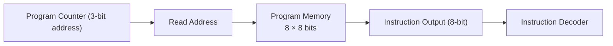

# Program Memory (PMEM)

## 1. Purpose

The Program Memory (PMEM) module stores the instructions executed by the TCPU-16 processor. It provides the instruction corresponding to the address supplied by the program counter.

The memory contains **8 instruction locations**, with each instruction being **8 bits wide**.

## 2. Block Diagram



### Block Diagram Explanation

- **Program Counter:** Supplies the address of the instruction to be read.
- **Read Address:** Selects one of the eight memory locations.
- **Program Memory:** Stores eight 8-bit instructions.
- **Instruction Output:** Provides the selected instruction to the decoder.
- **Instruction Decoder:** Interprets the opcode and operand fields.

## 3. Memory Organization

| Property | Description |
|---|---|
| Memory depth | 8 locations |
| Instruction width | 8 bits |
| Address width | 3 bits |
| Valid addresses | `0` to `7` |
| Memory capacity | 64 bits |
| Read operation | Address-selected instruction output |
| Write operation | Controlled by the program-loading interface |

## 4. Read Operation

The program counter provides a 3-bit address to the program memory. The instruction stored at that address is supplied to the instruction output.

Conceptually:

```text
instr = mem[read_addr]
```

The selected instruction is then passed to the decoder, which identifies the operation and operand.

## 5. Program Loading

The program memory is initialized through the program-loading interface.

- `write_en` enables writing an instruction.
- `write_addr` selects the memory location to write.
- `write_data` supplies the 8-bit instruction.
- The write operation occurs on the active clock edge, as implemented in the RTL.

Each instruction must be written to its intended address before program execution begins.

## 6. Example Program

The following table illustrates how instructions can be stored in program memory.

| Address | Instruction | Hex Code |
|---:|---|---|
| 0 | LOAD 18 | `0x12` |
| 1 | SHL 4 | `0x64` |
| 2 | ADD 3 | `0x23` |
| 3 | SUB 1 | `0x41` |
| 4 | SUB 1 | `0x41` |
| 5 | SUB 1 | `0x41` |
| 6 | HALT | `0xE0` |
| 7 | Filler | `0x00` |

The program counter selects each instruction according to the processor's execution sequence. The HALT instruction terminates execution according to the CPU control logic.

## 7. Verification

The program memory should be tested for:

- Correct writing to all eight addresses.
- Correct instruction output for each read address.
- Correct behavior when consecutive addresses are selected.
- Correct operation when `write_en` is disabled.
- Correct handling of program loading and execution sequencing.
- Correct integration with the program counter and instruction decoder.

## 8. Related Files

- `prog_mem.v` — implements the program memory.
- `dec.v` — decodes the fetched instruction.
- `toy_cpu16.v` — integrates the memory with the processor.
- `ops.md` — documents instruction encoding and behavior.
