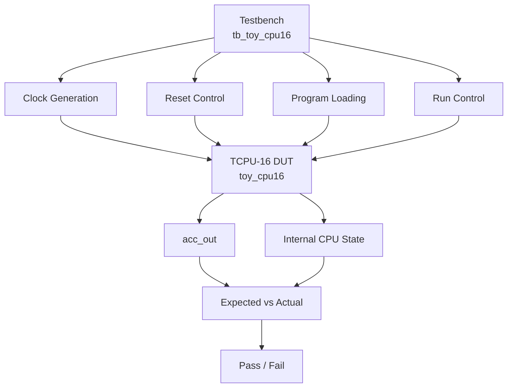

# TCPU-16 Testbench

## 1. Purpose

The `tb_toy_cpu16` testbench verifies the functionality of the TCPU-16 processor by applying input signals, loading instructions into program memory, running the processor, and checking its outputs.

The testbench is used to validate the processor's instruction execution, accumulator updates, program loading, control flow, and output-byte selection.

## 2. Testbench Block Diagram

### Block Diagram Explanation

- **Testbench:** Generates the stimulus and controls the verification sequence.
- **Clock Generation:** Produces the clock used by the processor.
- **Reset Control:** Applies reset before program execution.
- **Program Loading:** Supplies instruction bytes to the DUT.
- **Run Control:** Requests execution of the loaded program.
- **DUT:** The Device Under Test, instantiated from `toy_cpu16`.
- **Expected vs Actual:** Compares observed behavior with expected results.
- **Pass / Fail:** Indicates whether the tested conditions were satisfied.

## 3. Device Under Test

The DUT is the top-level `toy_cpu16` module.

The expected interface includes:

| Signal | Purpose |
|---|---|
| `clk` | Drives synchronous operations. |
| `rst_n` | Resets the processor; active low. |
| `prog_data` | Supplies program instruction bytes. |
| `prog_load` | Controls program loading. |
| `run` | Requests program execution. |
| `byte_sel` | Selects the accumulator byte to observe. |
| `acc_out` | Provides the selected 8-bit accumulator output. |

The exact port list must match the DUT's module declaration.

## 4. Testbench Operation

The testbench follows these general steps:

1. Initialize the input signals.
2. Generate the clock.
3. Apply reset according to the selected operating mode.
4. Load the program instructions into program memory.
5. Deassert `prog_load` after the final instruction is supplied.
6. Wait for the required synchronization interval.
7. Assert `run` to begin execution.
8. Observe the processor outputs and relevant internal state.
9. Compare the actual results with the expected values.
10. Report test success or failure.

The exact sequence and clock-edge timing must match the implemented testbench and project specification.

## 5. Example Test Program

A useful directed test program is one that constructs `0x0123`, subtracts three, and halts with an expected accumulator value of `0x0120`, assuming the RTL implements the instruction behavior described in `ops.md`.

| Address | Instruction | Hex Code |
|---:|---|---|
| 0 | LOAD 18 | `0x12` |
| 1 | SHL 4 | `0x64` |
| 2 | ADD 3 | `0x23` |
| 3 | SUB 1 | `0x41` |
| 4 | SUB 1 | `0x41` |
| 5 | SUB 1 | `0x41` |
| 6 | HALT | `0xE0` |
| 7 | Filler | `0x00` |

### Expected Output

If the final accumulator value is `16'h0120`, then:

| `byte_sel` | Expected `acc_out` |
|---:|---|
| `0` | `8'h20` |
| `1` | `8'h01` |

These values should be checked against the actual RTL behavior.

## 6. Verification Checks

The testbench should cover the following functional cases:

- Reset and initialization.
- Program loading into all valid memory locations.
- LOAD, ADD, SUB, SHL, and XOR instructions.
- Sequential program-counter progression.
- JMP target selection.
- JZ taken and not-taken conditions.
- HALT behavior.
- Lower-byte and upper-byte output selection.
- Correct transition from program loading to execution.

## 7. Randomized Verification

The project specification calls for at least **1,000 randomized fully loaded programs**, each exercised for **64 clock edges**, with randomized `run` toggles.

A complete randomized test should:

1. Generate a valid 8-word program.
2. Load all instruction words.
3. Follow the synchronization requirements for the selected operating mode.
4. Apply randomized `run` behavior.
5. Compare DUT behavior against a cycle-exact reference model.
6. Report mismatches and identify the failing test case.

Randomized testing supplements directed tests; it does not replace them.

## 8. Operating Modes

The testbench must respect the selected synchronization mode.

| Parameter | Mode H | Mode O |
|---|---:|---:|
| `SYNC_STAGES` | 0 | 2 |
| `N = SYNC_STAGES + 1` | 1 | 3 |

Reset and program-loading timing must satisfy the required clock-edge durations. The program data must remain stable while `prog_load` is high, and `run` must not be asserted until `prog_load` has been low for at least `N` clock edges after the final program word.

## 9. Pass / Fail Criteria

A test passes when the DUT behavior matches the expected behavior defined by the reference model and the applicable specification.

A test fails if, for example:

- The accumulator result is incorrect.
- A jump instruction selects the wrong address.
- JZ behaves incorrectly for either zero or nonzero accumulator values.
- HALT does not behave as specified.
- The output multiplexer selects the wrong byte.
- The observed state differs from the cycle-exact reference model.

A successful simulation should finish without assertion failures or unexplained mismatches.

## 10. Related Files

- `toy_cpu16.v` — top-level processor implementation.
- `ops.md` — instruction encoding and behavior.
- `alu.md` — ALU operations.
- `dec.md` — instruction decoding.
- `loader.md` — program loading.
- `pmem.md` — program memory.
- `npc.md` — next program counter.
- `omux.md` — output multiplexer.
