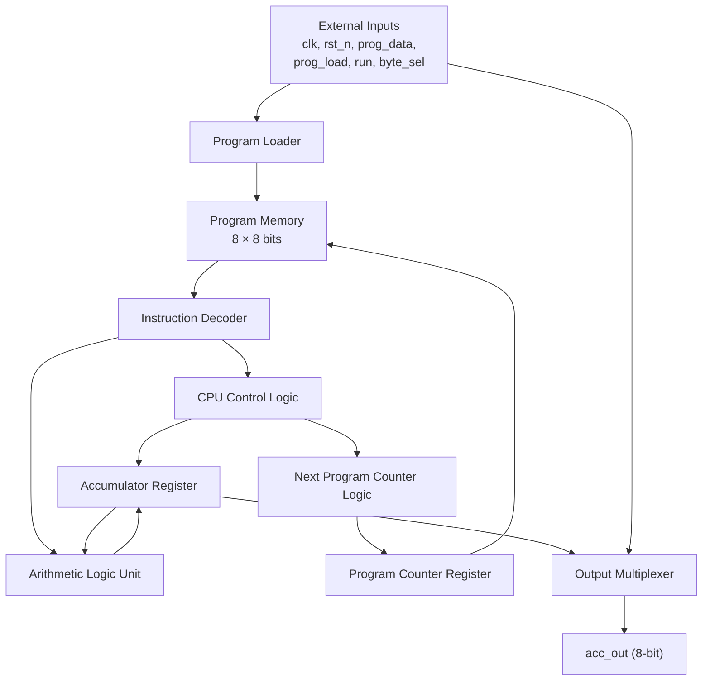

# TCPU-16 Processor

## 1. Overview

The TCPU-16 is a 16-bit accumulator-based processor with an 8-bit instruction format and an 8-word program memory. It executes arithmetic, logical, and control-flow instructions using its accumulator, instruction decoder, program memory, and control logic.

The top-level module, `toy_cpu16`, integrates the processor components and provides the external interface for reset, program loading, execution, and accumulator output.

## 2. Top-Level Block Diagram




## 3. Top-Level Interface

The following table describes the expected top-level interface.

| Signal | Direction | Description |
|---|---|---|
| `clk` | Input | Clock signal for synchronous CPU operations. |
| `rst_n` | Input | Active-low reset signal. |
| `prog_data` | Input | Supplies instruction data during program loading. |
| `prog_load` | Input | Controls the program-loading phase. |
| `run` | Input | Requests normal program execution. |
| `byte_sel` | Input | Selects the lower or upper accumulator byte. |
| `acc_out` | Output | Outputs the selected 8-bit accumulator byte. |

Confirm the signal names and directions against the actual module declaration in `toy_cpu16.v`.

## 4. Internal Components

### 4.1 Program Loader

The program loader coordinates the loading of instructions into program memory. It helps ensure that program loading is completed before normal execution begins.

See `loader.md`.

### 4.2 Program Memory

Program memory stores eight instructions, each 8 bits wide. The program counter supplies the address of the instruction to be fetched.

See `pmem.md`.

### 4.3 Instruction Decoder

The decoder interprets the 8-bit instruction by separating the opcode in bits `[7:5]` from the operand in bits `[4:0]`. The decoded instruction determines the operation and control flow.

See `dec.md` and `ops.md`.

### 4.4 Arithmetic Logic Unit

The ALU performs the arithmetic and logical operations supported by the instruction set:

- LOAD
- ADD
- SUB
- SHL
- XOR

The ALU result is supplied to the CPU datapath for updating the accumulator as directed by the control logic.

See `alu.md`.

### 4.5 Next Program Counter Logic

The next program counter logic determines the address of the next instruction. It supports sequential execution, unconditional jumps, conditional jumps, and the processor's halt behavior.

See `npc.md`.

### 4.6 Output Multiplexer

The output multiplexer selects either the lower or upper 8 bits of the 16-bit accumulator, based on `byte_sel`.

See `omux.md`.

## 5. Instruction Execution

The processor follows the general sequence below:

1. **Fetch:** The program counter selects an instruction from program memory.
2. **Decode:** The instruction decoder identifies the opcode and operand.
3. **Execute:** The ALU or control logic performs the required operation.
4. **Update:** The accumulator and/or program counter are updated as required.
5. **Repeat:** The processor continues execution until a HALT instruction stops normal execution.

The exact cycle timing and register-update behavior depend on the RTL implementation.

## 6. Instruction Set

| Opcode `[7:5]` | Instruction | Function |
|---|---|---|
| `000` | LOAD | Load an immediate operand. |
| `001` | ADD | Add the operand to the accumulator. |
| `010` | SUB | Subtract the operand from the accumulator. |
| `011` | SHL | Shift the accumulator left. |
| `100` | XOR | Perform a bitwise XOR operation. |
| `101` | JMP | Jump to the specified address. |
| `110` | JZ | Jump when the accumulator is zero. |
| `111` | HALT | Halt execution. |

See `ops.md` for the instruction format and examples.

## 7. Operating Modes

The TCPU-16 specification defines two synchronization configurations.

| Parameter | Mode H | Mode O |
|---|---:|---:|
| `SYNC_STAGES` | 0 | 2 |
| `N = SYNC_STAGES + 1` | 1 | 3 |

Reset and program-loading timing must comply with the selected mode. Program data must remain stable while `prog_load` is asserted, and execution must not begin until the required interval after program loading has elapsed.

The actual parameter configuration must be confirmed from the build configuration and RTL.

## 8. Example Program

The following example illustrates a program that constructs `0x0123`, subtracts three, and halts with an expected accumulator value of `0x0120`, assuming the instruction and operand behavior matches the implementation.

| Address | Hex Code | Instruction |
|---:|---|---|
| 0 | `0x12` | LOAD 18 |
| 1 | `0x64` | SHL 4 |
| 2 | `0x23` | ADD 3 |
| 3 | `0x41` | SUB 1 |
| 4 | `0x41` | SUB 1 |
| 5 | `0x41` | SUB 1 |
| 6 | `0xE0` | HALT |
| 7 | `0x00` | Filler |

Expected accumulator and output values:

```text
ACC = 16'h0120

byte_sel = 0  -> acc_out = 8'h20
byte_sel = 1  -> acc_out = 8'h01
```

These expected values should be validated against the actual RTL and simulation results.

## 9. Verification

The top-level processor should be verified for:

- Correct reset behavior.
- Correct program loading.
- Correct instruction fetch and decode.
- Correct arithmetic and logical operations.
- Correct sequential program-counter updates.
- Correct JMP and JZ behavior.
- Correct HALT behavior.
- Correct output-byte selection.
- Correct Mode H and Mode O synchronization behavior.
- Correct operation under directed and randomized test programs.

The project specification calls for cycle-exact reference-model checks and at least 1,000 randomized fully loaded programs, each exercised for 64 clock edges with randomized `run` toggles.

## 10. Related Documentation

- `alu.md` — Arithmetic Logic Unit.
- `dec.md` — Instruction Decoder.
- `loader.md` — Program Loader.
- `npc.md` — Next Program Counter.
- `omux.md` — Output Multiplexer.
- `ops.md` — Instruction Set.
- `pmem.md` — Program Memory.
